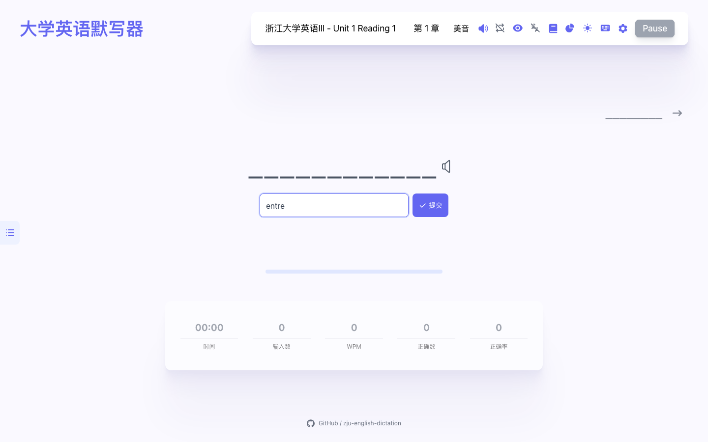
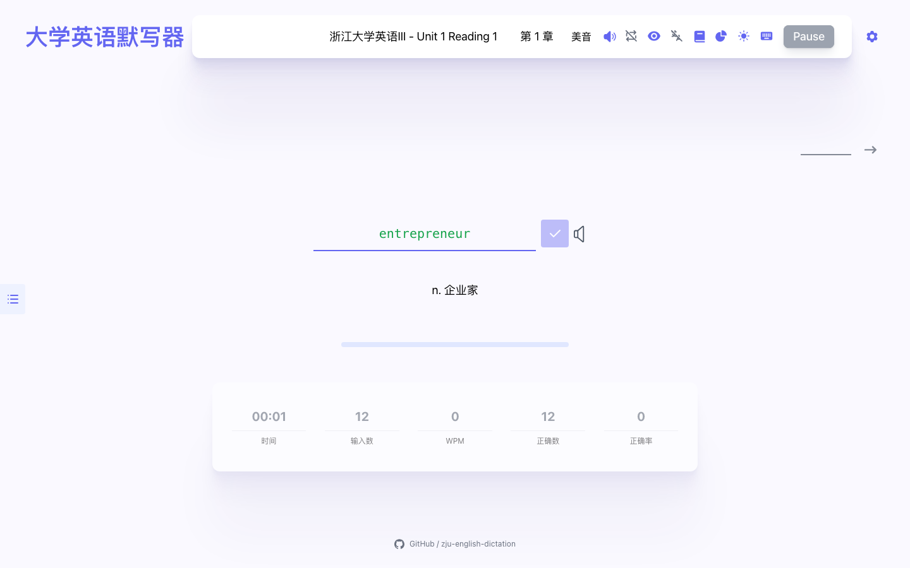
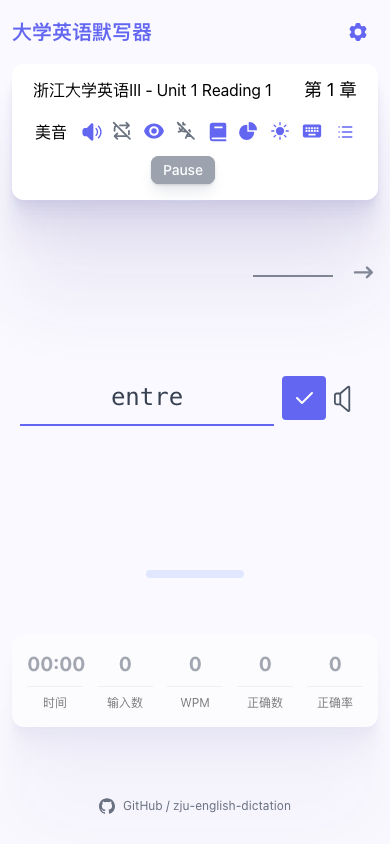
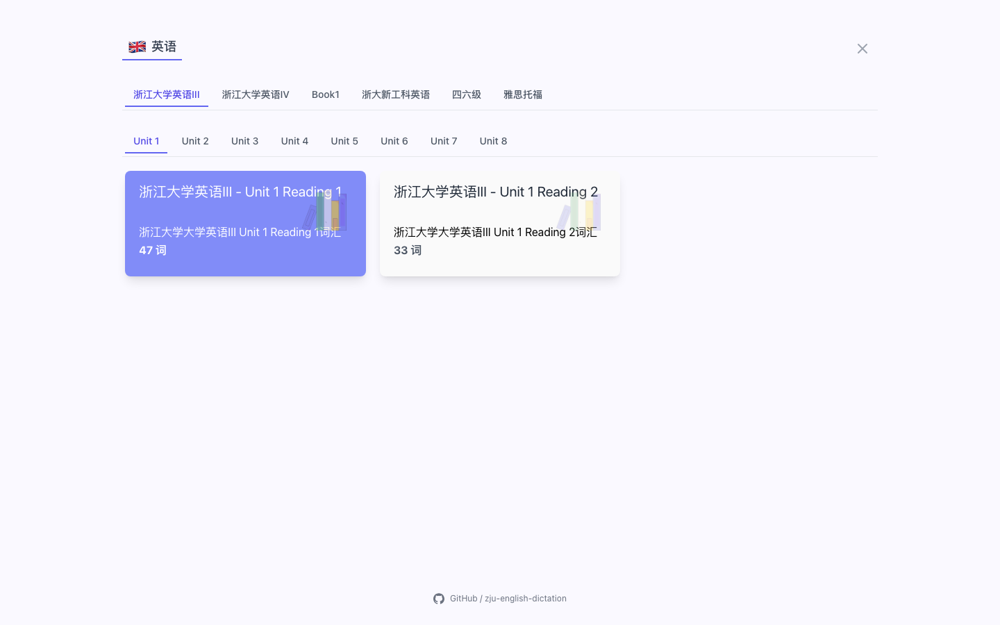

# 🎧 大学英语默写器

**像课堂听写一样：听到单词，默写英文，回忆中文，再核对释义。**

老师读单词的时候：「这个我背过！」😎 轮到自己写的时候：「等等，怎么拼来着……」🫠

所以，我把浙江大学大学英语 III、IV 的单元词汇整理成了这个小工具。选好正在学的单元，就能开始一场听写练习，不用注册，也不用找人帮忙报单词。打开就练，今天也争取少错一个！✍️

### [🚀 点这里开始听写 → zju-english-dictation.panjoel.top](https://zju-english-dictation.panjoel.top/)

[🎧 怎么听写](#dictation) · [📸 看看页面](#preview) · [📚 找找词库](#dictionaries) · [💻 本地运行](#local-run) · [⭐ 给我一颗 Star](#star)



<a id="dictation"></a>

## 🎧 先听，再写，答案先藏好

课堂上，老师读一个单词，我们既要写出英文，也要知道它的中文意思。这个项目最想保留的，就是这一步从声音到拼写、再到词义的回忆过程。**不只是「看着会」，还要试试「听到也能写」！** 🧠✨

> 🎧 耳朵：「听到了！」 → ✍️ 手：「我来拼！」 → 🤔 脑袋：「中文意思呢？」 → ✅ 答案：「来核对一下～」

| 环节    | 在这里怎么练                                                               |
| ------- | -------------------------------------------------------------------------- |
| 🎧 听音 | 播放单词发音，支持美音、英音与再次播放。没听清？再来一遍～                 |
| ✍️ 默写 | 开启「全部隐藏」，根据声音输入英文，逐字检查拼写。答案先不剧透！           |
| 🤔 回忆 | 默认关闭中文释义，输入时先在心里想出中文意思。给大脑一点独立完成的机会。   |
| ✅ 核对 | 拼写完成后显示中文约 1.2 秒，再进入下一词；上一个单词及其中文仍可回看。    |
| 📒 复习 | 每完成一个单词保存练习记录，结合错题本和统计继续复习。错过的，再认识一次。 |

💡 **这里的“英文 + 中文”指英文输入、中文回忆后核对。没有中文输入框，也不会自动给中文答案判分。** 想更像课堂听写的话，可以在手边放一张纸，边听边写下中文，再对照页面检查。纸笔搭档也欢迎加入！📝

### 🕹️ 四步，开始这一轮

1. 点击顶部词库名称，选择英语 III / IV 对应单元及章节。
2. 打开「默写模式」，开启开关并选择「全部隐藏」。中文释义默认关闭；纯听音练习时，可在发音设置中关闭音标。
3. 点击 **Start**，听发音后输入英文，同时回忆中文意思。手机也使用这一页，点击开始或「输入英文」即可聚焦输入框。
4. 答对后核对中文，继续下一词。没有听清时，点击单词旁的扬声器再次播放。

🔎 小提醒：首次打开时，英文默认可见，可以先混个脸熟；开启默写模式后才会隐藏英文。发音需要网络，移动浏览器可能要求先点击页面才能播放声音。

<a id="preview"></a>

## 📸 先给你看看它的样子

不是概念图，是可以直接用的真实页面哦。示例使用英语 III Unit 1 Reading 1，开启全部隐藏并关闭音标。👀

### ✅ 拼完英文，中文出来对答案啦



### 📱 手机也来，一起听写



手机沿用网页版的词库、听写规则与记录方式，没有另做一套功能不同的手机版。输入框支持软键盘，切到下一词或循环同一个词时保留焦点。截图不包含操作系统软键盘。

### 📚 学到哪个单元，就找到哪一份



<a id="dictionaries"></a>

## 📚 你的单元词库，请查收

| 课程 / 类别     | 整理方式                                 |         词条数 |
| --------------- | ---------------------------------------- | -------------: |
| 大学英语 III    | Unit 1–8，每单元 Reading 1 / 2，共 16 份 |            580 |
| 大学英语 IV     | Unit 1–8，共 8 份                        |            720 |
| Book 1 Unit 1–4 | 原始清单合并为 1 份                      |            245 |
| 四六级          | CET-4、CET-6                             | 按独立词库练习 |
| 雅思托福        | IELTS、TOEFL                             | 按独立词库练习 |

浙大课程资料共整理 **1,545 条词条**，按文件计数，未跨词库去重。默认进入英语 III Unit 1 Reading 1，词库页把浙江大学英语放在最前面，另外保留四六级、雅思托福分类。先把这周的单元拿下，再去别的词库逛逛～ 🗂️

词库位于 [`public/dicts`](public/dicts)，注册信息在 [`src/resources/dictionary.ts`](src/resources/dictionary.ts)。英语 IV 来自「大英四单词表」；Book 1 来自 `book1 u1-4.txt`。**Book 1 原文件没有中文释义，因此这份词库暂不能用于答后中文核对。** 不补写未经校对的翻译。

## 💾 练习记录放在哪里呀？

- 已完成单词的练习记录、错题与统计保存在当前浏览器的 IndexedDB 中，刷新页面不会清除。
- 词库、章节与部分设置使用浏览器本地存储；普通练习刷新后从所选章节开头开始，不承诺恢复未完成单词。
- 不同设备、浏览器和网址之间不会自动同步。例如本地地址与在线域名的记录相互独立。
- 清理站点数据或使用无痕模式可能丢失记录。可在「设置 → 数据」中导出备份；导入会覆盖当前数据，请先备份。

🔐 小声但认真地提醒：重要记录记得备份，别让清理浏览器把努力也一起清掉了。

<a id="local-run"></a>

## 💻 在自己的电脑上跑起来

需要 Node.js 和 npm。建议使用 Node.js 22 或 24；进入项目目录后执行：

```bash
npm install
npm run dev -- --host 127.0.0.1 --port 5174
```

浏览器打开 [http://127.0.0.1:5174/](http://127.0.0.1:5174/)。端口被占用时，以终端实际输出的地址为准。

macOS 也可以在安装依赖后，双击 [`start-qwerty-learner.command`](start-qwerty-learner.command) 启动并打开浏览器。

### 📦 构建与部署

```bash
npm run build
npx vite preview --host 127.0.0.1 --port 4173
```

构建结果在 **`build/`，不是 `dist/`**。使用 [http://127.0.0.1:4173/](http://127.0.0.1:4173/) 预览，不要直接双击 `build/index.html`，否则浏览器可能因 `file://` 限制无法加载脚本。

Vercel 配置已写入 [`vercel.json`](vercel.json)：Vite、`npm run build`、输出目录 `build`，并将前端路由回退到 `index.html`。

### 📊 看看有多少人来练习

项目已接入 **Vercel Web Analytics**，用于查看访客数和页面浏览量。这里是 Vite + React 项目，根组件使用的是 `@vercel/analytics/react`，不是 Next.js 的 `/next` 入口，不需要重复安装或重复挂载组件。

部署自己的副本时，在 Vercel 项目中启用 Web Analytics，再部署并访问页面。随后到 Analytics 面板查看数据；若没有显示，先检查广告拦截或内容拦截扩展。配置步骤见 [Vercel 官方文档](https://vercel.com/docs/analytics/quickstart?framework=react)。🛠️

### 🧪 回归检查与截图

先启动本地开发服务并安装 Google Chrome，再运行：

```bash
npm run test:dictation
npm run screenshots:readme
```

回归检查覆盖手机点击开始、焦点保持、批量与组合输入、英文短语、中文揭示、记录持久化、设置操作、横竖屏宽度及桌面键盘输入。截图脚本使用真实词库，输出到 [`assets/readme`](assets/readme)。可用 `TEST_URL` 指定其他测试地址。

浏览器模拟可以检查焦点和布局，但不能替代 iOS / Android 真机对系统软键盘、输入法与自动播放限制的验证。

<a id="star"></a>

## ⭐ 可以送我一颗小星星吗？

如果这个小工具帮你练熟了几个单词，或者让考前听写没那么手忙脚乱，**可以给我的仓库点一颗 Star 吗？** 🥹✨

👉 [去 GitHub 给大学英语默写器点 Star](https://github.com/panjoel812/zju-english-dictation)

登录 GitHub 后，点一下仓库右上角的 **Star** 就好，不用付费。你的这颗小星星，会让我知道：原来还有同学在用我做的小工具呀。谢谢你！(๑•̀ㅂ•́)و✧

发现词条有误、页面哪里不好用，也欢迎 [提一个 Issue](https://github.com/panjoel812/zju-english-dictation/issues)。描述一下遇到的问题，我才更容易把它改好～ 💬

## 💙 来源与致谢

本项目由 **[RealKai42/qwerty-learner](https://github.com/RealKai42/qwerty-learner)** 改编而来，专门为**浙江大学大学英语 III、IV 的单词默写**整理。感谢原项目提供的打字练习、词库和学习记录基础；本仓库重点调整课程词库、答后中文核对流程与移动端适配。

这是个人课程学习项目，并非浙江大学官方产品。代码沿用上游 **GPL-3.0** 许可证，见 [`LICENSE`](LICENSE)；课程词表、释义与第三方发音资源的权利归各自权利人所有。

祝我们下次听到熟悉的单词时，都能从「我好像背过」变成「这个我会写！」🎧✍️🥳
