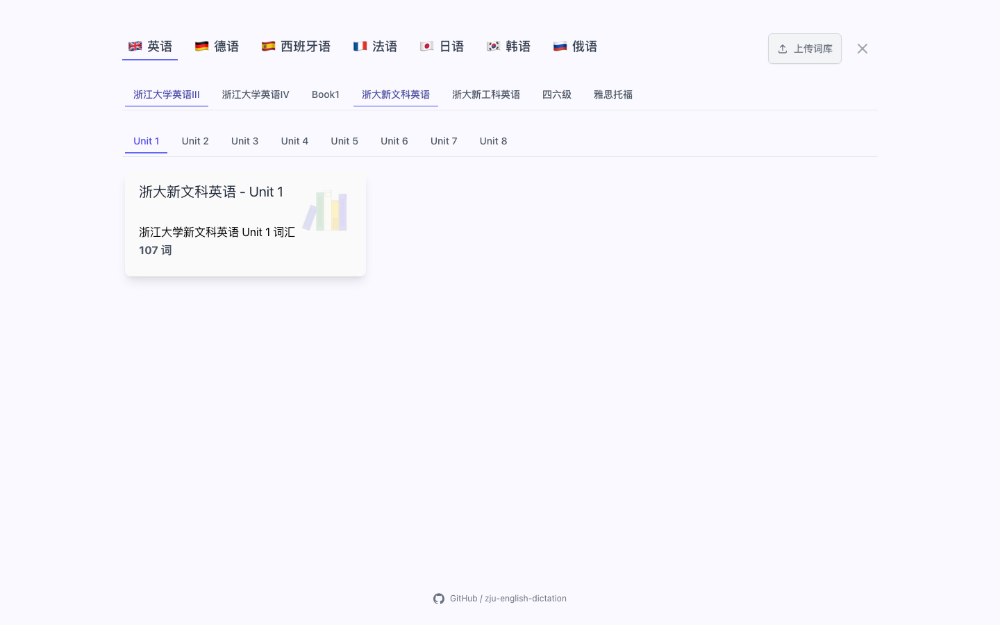

# ZED 介绍推文

浙大新文科英语的同学，这次也能一起练起来啦！📚

**ZED（ZJU English Dictation）** 把每天的英语复习变成一场短而有反馈的练习：看中文默写单词，按首字母完成句子，用小测专题练 Vocabulary 和 Sentence Completion；打不出来时可以查看答案，做过的题会自动跳过。Book II 之外，现在也加入了 **浙大新文科英语 Unit 1–8**，从课堂词表一路练到考试题感。

还想换换脑子？德语、西班牙语、法语、日语、韩语、俄语的小语种课程词库也已经准备好。今天背下的一个词，可能就是明天读懂一段文章、写出一句漂亮表达的那块拼图。

感谢：

- 浙大新文科英语词表：@HFanGDoDM
- 小语种课程单词默写器（德语/西语/法语/日语/韩语/俄语）：[CC98 主题](https://www.cc98.org/topic/6549358)

👉 点击打开 ZED：ZJU English Dictation

如果你也在浙大读大学英语 III，欢迎来试试，让键盘上的每一次敲击都留下进步的回声！
